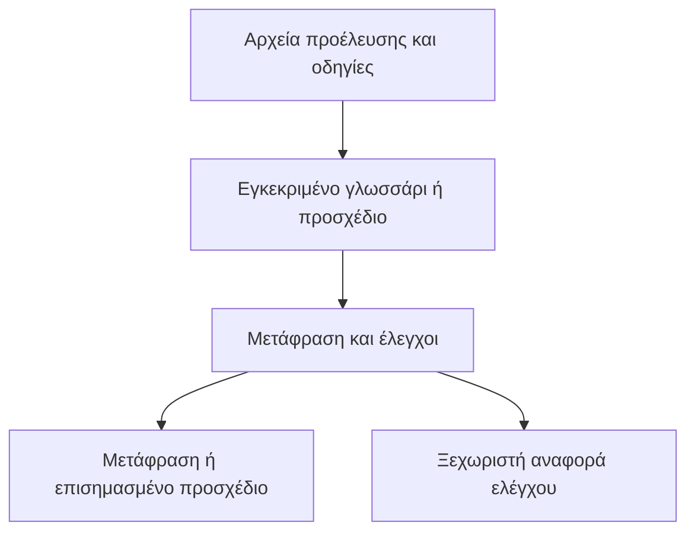

# Game Localization

Το Game Localization είναι μια δεξιότητα για πράκτορες που μεταφράζει, επιμελείται και ελέγχει κείμενα παιχνιδιών στο ChatGPT, το Codex και το Claude. Καλύπτει μενού, οδηγούς εκμάθησης, διαλόγους, υπότιτλους, κείμενα καταστημάτων και τεκμηρίωση έργων για Steam, PlayStation, Xbox και παιχνίδια για κινητά.

Λαμβάνετε μετάφραση και ξεχωριστή αναφορά ελέγχου.

**[Εγκατάσταση](#εγκατάσταση)** · **[Δοκιμάστε το παράδειγμα με 12 συμβολοσειρές](../game-localization/examples/first-run/README.md)** · [Χρήση της δεξιότητας](#χρήση-της-δεξιότητας)

[English](../README.md) · [Όλες οι γλώσσες](../README.md#languages)

## Εγκατάσταση

| Περιβάλλον | Πακέτο |
| --- | --- |
| ChatGPT ή Codex με δικαίωμα μεταφόρτωσης προσθέτων | [ZIP προσθέτου ChatGPT](../packages/game-localization-chatgpt-v0.1.13.zip) |
| Claude ή χώρος ChatGPT με δικαίωμα μεταφόρτωσης αυτόνομων δεξιοτήτων | [ZIP αυτόνομης δεξιότητας](../packages/game-localization-skill-v0.1.13.zip) |
| Τοπικό Codex ή Claude Code | [Κατάλογος GitHub](plugin-catalog.md) |

Ανοίξτε τον σύνδεσμο του πακέτου στο GitHub και επιλέξτε **Download raw file**. Μεταφορτώστε το ZIP χωρίς αποσυμπίεση.

[Λεπτομέρειες εγκατάστασης](#setup-details) · [Εγκατάσταση από τον πηγαίο φάκελο](#εγκατάσταση-για-τοπικούς-πράκτορες-με-μία-εντολή)

## Χρήση της δεξιότητας

### Πώς λειτουργεί

1. Επισυνάψτε το κείμενο ή αρχείο προέλευσης και το ενημερωμένο γλωσσάρι του έργου για τις γλώσσες-στόχους. Αν δεν υπάρχει γλωσσάρι, ζητήστε ρητά ένα προσχέδιο.
2. Δηλώστε γλώσσα προέλευσης και γλώσσες-στόχους, πλατφόρμα, είδος υλικού και μορφή παράδοσης. Προσθέστε κατά περίπτωση όρια χαρακτήρων, στιγμιότυπα, σημειώσεις ομιλητών ή παραδείγματα μεταβλητών.
3. Για υπολογιστικά φύλλα, δηλώστε τις στήλες προέλευσης και προορισμού και ζητήστε νέο αντίγραφο. Για κείμενα παιχνιδιού, δώστε σταθερά αναγνωριστικά ή κλειδιά. Για κείμενο καταστήματος, δηλώστε το πεδίο και τυχόν αυστηρό όριο.
4. Δείτε στις χωριστές σημειώσεις παράδοσης αν το αποτέλεσμα είναι έτοιμο για χρήση ή παραμένει προσχέδιο. Οι σημειώσεις παρουσιάζουν ξεχωριστά τον έλεγχο του αρχείου, τον γλωσσικό έλεγχο και τον έλεγχο στο παιχνίδι ή στην προεπισκόπηση του καταστήματος, με το επόμενο βήμα για κάθε εκκρεμότητα. Εγκρίνετε τους όρους στο γλωσσάρι του έργου πριν τους χρησιμοποιήσετε ξανά.

### Επιλέξτε διαδικασία

| Μορφή | Τι να δώσετε | Τι θα λάβετε |
| --- | --- | --- |
| [CSV](../game-localization/references/csv-qa.md) | CSV με σταθερά ID γραμμών (και τα προηγούμενα αρχεία για ενημερώσεις) | Ελεγμένη μετάφραση ή αναφορά αλλαγών |
| [Excel](../game-localization/references/xlsx-qa.md) | Βιβλίο εργασίας, φύλλο και στήλες ID, προέλευσης και προορισμού | Ελεγμένο αντίγραφο του βιβλίου |
| [Steam](../game-localization/references/steam-store.md) | Κείμενο καταστήματος ή εξαγωγή Steamworks | Τοπικοποιημένα πεδία ή προσχέδιο JSON |

Παραδείγματα οδηγιών και έλεγχοι αρχείων

Για το περιβάλλον χρήστη του παιχνιδιού, η παράδοση περιλαμβάνει λίστα ελέγχων κατά προτεραιότητα με οθόνη, ID συμβολοσειράς, βήματα αναπαραγωγής και κριτήρια επιτυχίας. Προηγούνται οι μεγάλες τιμές μεταβλητών και το κείμενο που κινδυνεύει να κοπεί. Αν είναι γνωστά η γραμματοσειρά και το διαθέσιμο πλάτος, η δεξιότητα μπορεί να εκτιμήσει τον απαιτούμενο χώρο. [Έλεγχοι στο παιχνίδι](../game-localization/references/in-build-qa.md)

Χρησιμοποιήστε το [πρότυπο γλωσσαρίου έργου](../game-localization/references/project-glossary-template.md) για να κρατάτε τους εγκεκριμένους όρους χωριστά από τις προτάσεις. Αποθηκεύστε το ενημερωμένο αρχείο και επισυνάψτε το στην επόμενη συνομιλία σας.

**Παράδειγμα προτροπής για υπολογιστικό φύλλο**

~~~text
Χρησιμοποίησε το Game Localization για να μεταφράσεις τη στήλη ENGLISH του συνημμένου βιβλίου εργασίας στα γερμανικά (de-DE). Γράψε τις μεταφράσεις στη GERMAN σε νέο αντίγραφο .xlsx. Χρησιμοποίησε το συνημμένο γλωσσάρι και τη στήλη DESCRIPTION ως συμφραζόμενα. Διατήρησε κλειδιά, στήλες προέλευσης, σύμβολα κράτησης θέσης και ετικέτες. Κατάγραψε χωριστά τις ερωτήσεις ορολογίας και τους ελέγχους μαζί με τα ID γραμμών.
~~~

Για υποστηριζόμενα αρχεία `.xlsx`, ορίστε το φύλλο, τη γραμμή επικεφαλίδων, τη στήλη με τα σταθερά ID, τη στήλη προέλευσης και την υπάρχουσα στήλη προορισμού. Με Python 3.9 ή νεότερη, η δεξιότητα γράφει τις μεταφράσεις βάσει ID σε νέο αντίγραφο και ελέγχει αν διατηρήθηκε το υπόλοιπο βιβλίο εργασίας. Αν δεν μπορεί να το επαληθεύσει, μπορεί να προσφέρει αρχείο CSV με ID. [Οδηγίες για το Excel](../game-localization/references/xlsx-qa.md)

**Παράδειγμα προτροπής για σελίδα καταστήματος**

~~~text
Χρησιμοποίησε το Game Localization για να προσαρμόσεις αυτή τη σύντομη περιγραφή Steam από τα αγγλικά στα πορτογαλικά Βραζιλίας (pt-BR). Ετοίμασε προσχέδιο γλωσσαρίου αν χρειάζεται. Κράτησε τον τίτλο του παιχνιδιού και τήρησε το όριο χαρακτήρων. Παράδωσε χωριστά το κείμενο καταστήματος και τις σημειώσεις παράδοσης.
~~~

Για σελίδες του Steam, η δεξιότητα επιστρέφει χωριστά τη σύντομη περιγραφή και την ενότητα «Σχετικά με αυτό το παιχνίδι», ελέγχει τα καθορισμένα όρια και τους ισχυρισμούς για το παιχνίδι και μπορεί να ετοιμάσει προσχέδιο από υποστηριζόμενη εξαγωγή JSON του Steamworks. Η παράδοση καταγράφει χωριστά την εισαγωγή και την προεπισκόπηση. [Ροή εργασίας για σελίδες Steam](../game-localization/references/steam-store.md)

### Έλεγχος μεταφράσεων σε CSV

Για ένα CSV με σταθερά αναγνωριστικά γραμμών, ορίστε τις κεφαλίδες των στηλών για το αναγνωριστικό, το πρωτότυπο και τη μετάφραση. Αν είναι διαθέσιμη η Python 3.9 ή νεότερη έκδοση, η δεξιότητα συγκρίνει το αρχείο του πρωτοτύπου με το αρχείο της μετάφρασης και επισημαίνει αναγνωριστικά που λείπουν ή εμφανίζονται δύο φορές, κενές μεταφράσεις, αλλαγές σε υποστηριζόμενα σύμβολα κράτησης θέσης ή ετικέτες και υπερβάσεις των ορίων μήκους. [Οδηγίες ελέγχου CSV](../game-localization/references/csv-qa.md)

Για να ενημερώσετε μια μετάφραση, επισυνάψτε το προηγούμενο και το τρέχον CSV προέλευσης, τις εγκεκριμένες μεταφράσεις και τυχόν μεταγενέστερες διορθώσεις του επιμελητή. Η δεξιότητα αντιστοιχίζει τις γραμμές βάσει ID, διατηρεί τις κατάλληλες διατυπώσεις για τις αμετάβλητες γραμμές και επισημαίνει όσες προστέθηκαν, άλλαξαν ή αφαιρέθηκαν. Στους μεγάλους διαλόγους, αποθηκεύστε την πρόοδο μετά από κάθε σκηνή για να συνεχίσετε με το ίδιο αρχείο εργασίας. [Ενημέρωση μεταφράσεων CSV](../game-localization/references/csv-updates.md)

## Δυνατότητες

- Εφαρμόζει την εγκεκριμένη ορολογία του έργου και καταγράφει νέους όρους ως προτάσεις.
- Διατηρεί κλειδιά τοπικοποίησης, σύμβολα κράτησης θέσης όπως `{player_name}` και `%s`, ετικέτες, σημαντικές αλλαγές γραμμής και άλλα προστατευμένα στοιχεία.
- Ελέγχει τα όρια μήκους και κρατά τη μετάφραση χωριστά από ερωτήσεις, διορθώσεις του πρωτοτύπου και σημειώσεις ποιοτικού ελέγχου.
- Προσφέρει [προκαθορισμένη λίστα 30 γλωσσών και παραλλαγών](../game-localization/references/game-localization-rules-v0.1.md#21-select-target-languages) και δέχεται προσαρμοσμένες λίστες.
- Περιλαμβάνει [αρχικό γλωσσάρι 75 όρων και για τις 30 γλώσσες και παραλλαγές](../game-localization/references/glossary/README.md), με κοινούς αγγλικούς ορισμούς και προτεινόμενες μεταφράσεις.

Η δεξιότητα περιέχει οδηγίες και αρχεία αναφοράς. Λειτουργεί χωρίς κλειδί API έργου, σύνδεσμο υπηρεσίας ή υπηρεσία παρασκηνίου. Η επεξεργασία αρχείων εξαρτάται από τα εργαλεία της συνομιλίας. Πριν από την κυκλοφορία, ελέγξτε τη μεταφρασμένη διεπαφή στην έκδοση του παιχνιδιού και τα κείμενα καταστήματος στην προεπισκόπηση της πλατφόρμας.

## Ενημέρωση ή κατάργηση

| Τρόπος εγκατάστασης | Ενημέρωση | Κατάργηση |
| --- | --- | --- |
| [Κατάλογος GitHub](plugin-catalog.md) | [Claude Code](plugin-catalog.md#claude-code) · [Codex](plugin-catalog.md#local-codex) | [Κατάργηση](plugin-catalog.md#remove-the-catalog-installation) |
| Πρόσθετο ChatGPT ή Codex | Αν διαχειρίζεστε τη μεταφόρτωση, επιλέξτε **Upload new version** στις λεπτομέρειες. Οι εγκαταστάσεις από κατάλογο ή χώρο εργασίας ενημερώνονται από την αντίστοιχη πηγή. | Ανοίξτε **Plugins → Installed → Game Localization** και επιλέξτε **Uninstall plugin** αν προσφέρεται. Για διαχειριζόμενη εγκατάσταση, απευθυνθείτε στον διαχειριστή. |
| Αυτόνομη δεξιότητα ChatGPT | Αντικαταστήστε την προσωπική μεταφόρτωση με το νεότερο αυτόνομο ZIP μέσω της διαχείρισης δεξιοτήτων. | Ανοίξτε **Plugins → Skills**, βρείτε τη δεξιότητα στο **Installed** ή **Created by me** και χρησιμοποιήστε την επιλογή κατάργησης. Οι διαχειριστές διαχειρίζονται τις δεξιότητες του χώρου. |
| Προσαρμοσμένη δεξιότητα Claude | Μεταφορτώστε το νέο αυτόνομο ZIP από τη διαχείριση. Απενεργοποιήστε την παλιά έκδοση αν εμφανιστεί δεύτερη καταχώριση. | Ανοίξτε τη δεξιότητα από **Customize → Skills** ή **Plugins** και απενεργοποιήστε τη. Για δική σας μεταφόρτωση, επιλέξτε **⋯ → Delete** και επιβεβαιώστε. |
| Τοπική δεξιότητα μέσω Skills CLI | Εκτελέστε `npx skills update game-localization` για κλάδο που παρακολουθείτε ή εγκαταστήστε από τη νέα ετικέτα. | Εκτελέστε `npx skills remove game-localization` στο ίδιο έργο. Προσθέστε `-g` για εγκατάσταση σε καθολικό επίπεδο. |
| Τοπικός φάκελος ή Codex Skill Installer | Αντικαταστήστε τον φάκελο `game-localization/` με τη νεότερη έκδοση. | Καταργήστε τον φάκελο `game-localization/`. Το Codex φορτώνει από `.agents/skills/`, `~/.agents/skills/` ή `~/.codex/skills/`. Το Claude Code χρησιμοποιεί `.claude/skills/` ή `~/.claude/skills/`. Ανοίξτε νέα συνεδρία αν χρειάζεται. |

[Διαχείριση προσθέτων OpenAI](https://learn.chatgpt.com/docs/plugins) · [Διαχείριση προσαρμοσμένων δεξιοτήτων Claude](https://support.claude.com/en/articles/12512180-use-skills-in-claude)

## Λεπτομέρειες εγκατάστασης

### ChatGPT και Codex

1. Στο ChatGPT στον ιστό, ανοίξτε την επιλογή μεταφόρτωσης προσθέτου. Οι εξουσιοδοτημένοι ιδιοκτήτες και διαχειριστές μπορούν να χρησιμοποιήσουν **Admin console → Plugins → Add → Upload plugin**.
2. Επιλέξτε το ZIP του προσθέτου. Μετά την επικύρωση, ανοίξτε το **Game Localization** στα **Plugins** και επιλέξτε **Install plugin**, αν προσφέρεται. Οι προσωπικές μεταφορτώσεις μπορεί να εμφανίζονται στο **Personal → Created by me**.
3. Ανοίξτε νέα συνομιλία στο ChatGPT ή το Codex. Πληκτρολογήστε `@` και επιλέξτε **Game Localization** από τις προτάσεις.

Αν ο χώρος υποστηρίζει αυτόνομες δεξιότητες, μεταφορτώστε το αντίστοιχο ZIP από **Plugins → Skills → Create → Upload from your computer**. Περιμένετε τη σάρωση και ακολουθήστε τις οδηγίες. Οι επιλογές εξαρτώνται από τον λογαριασμό και τον χώρο εργασίας. [Οδηγός προσθέτων OpenAI](https://help.openai.com/en/articles/20001256-plugins-in-chatgpt) · [Οδηγός δεξιοτήτων OpenAI](https://help.openai.com/en/articles/20001066-skills-in-chatgpt)

### Claude

1. Ενεργοποιήστε το **Code execution and file creation** στις ρυθμίσεις Claude, αν το απαιτεί ο λογαριασμός ή ο χώρος εργασίας.
2. Στο Claude στον ιστό ή στο Claude Desktop ανοίξτε **Customize → Skills**. Στη νέα διάταξη ανοίξτε **Plugins** στην πλαϊνή γραμμή και αναζητήστε τα στοιχεία διαχείρισης στο **Your plugins**.
3. Επιλέξτε **+ → Create skill → Upload a skill** και το ZIP της αυτόνομης δεξιότητας. Ενεργοποιήστε το `game-localization` όταν εμφανιστεί.
4. Ανοίξτε νέα συνομιλία και ζητήστε από το Claude να χρησιμοποιήσει το **Game Localization**. Αν η δεξιότητα εμφανίζεται στο **+** ή **/** του πεδίου μηνύματος, επιλέξτε την εκεί.

Σε διαχειριζόμενο χώρο εργασίας, ενδέχεται να χρειαστεί διαχειριστής για την ενεργοποίηση ή μεταφόρτωση δεξιοτήτων. [Οδηγός δεξιοτήτων Claude](https://support.claude.com/en/articles/12512180-use-skills-in-claude) · [Νέα πλαϊνή γραμμή Claude](https://support.claude.com/en/articles/17740565-manage-plugins-skills-and-connectors-from-one-plugins-page)

### Εγκατάσταση για τοπικούς πράκτορες με μία εντολή

Εμφάνιση εντολών μη αυτόματης εγκατάστασης

Σε τοπική συνομιλία Codex, επιλέξτε το ενσωματωμένο `$skill-installer` και στείλτε το παρακάτω αίτημα. Επιτρέψτε πρόσβαση στο δίκτυο αν ζητηθεί και ανοίξτε νέα συνεδρία. [Οδηγός δεξιοτήτων Codex](https://learn.chatgpt.com/docs/build-skills)

~~~text
$skill-installer Install the skill from https://github.com/Maled1kt/game-localization/tree/main/game-localization
~~~

Το εργαλείο τρίτου Skills CLI εγκαθιστά τον ίδιο πηγαίο φάκελο για τοπικό Codex και Claude Code με μία εντολή. Εκτελέστε την στο έργο προορισμού με Node.js 22.20 ή νεότερο. Κρατήστε τα `-a` για τους πράκτορες που χρειάζεστε. Προσθέστε `-g` για εγκατάσταση σε επίπεδο χρήστη. [Τεκμηρίωση Skills CLI](https://github.com/vercel-labs/skills/blob/main/docs/commands.md#skills-add)

~~~bash
npx skills add https://github.com/Maled1kt/game-localization/tree/main/game-localization -a codex -a claude-code
~~~

Στη συνομιλία του τοπικού τερματικού Claude Code, χρησιμοποιήστε το πεδίο του κελύφους για εγκατάσταση μόνο στο Claude. Ελέγξτε το URL του αποθετηρίου πριν από την εκτέλεση. [Είσοδος κελύφους στο Claude Code](https://code.claude.com/docs/en/interactive-mode#shell-mode-with--prefix)

~~~text
! npx skills add https://github.com/Maled1kt/game-localization/tree/main/game-localization -a claude-code
~~~

Σε νέα συνεδρία καλέστε `$game-localization` στο Codex ή `/game-localization` στο Claude Code. Για μη αυτόματη εγκατάσταση, αντιγράψτε όλο τον φάκελο `game-localization/` στο `.claude/skills/` του έργου ή στο `~/.claude/skills/` του χρήστη. [Οδηγός δεξιοτήτων Claude Code](https://code.claude.com/docs/en/skills)

Στις φιλοξενούμενες εκδόσεις ChatGPT και Claude, χρησιμοποιήστε τις επιλογές μεταφόρτωσης ή εγκατάστασης του λογαριασμού. Μια αναφορά στη συνομιλία καλεί την εγκατεστημένη δεξιότητα. Για σύνδεσμο εγκατάστασης προς κοινοποίηση, δημοσιεύστε στον κατάλογο της πλατφόρμας ή μοιραστείτε τη δεξιότητα ή το πρόσθετο σε κατάλληλο χώρο εργασίας. [Κοινοποίηση προσθέτων ChatGPT](https://help.openai.com/en/articles/20001256-plugins-in-chatgpt) · [Κοινοποίηση δεξιοτήτων Claude](https://support.claude.com/en/articles/12512180-use-skills-in-claude)

## Πηγαία αρχεία και πακέτα

- [`game-localization/SKILL.md`](../game-localization/SKILL.md) ορίζει πότε εκτελείται η δεξιότητα και πώς επεξεργάζεται μια παρτίδα κειμένων.
- [`game-localization/references/`](../game-localization/references/) περιέχει τους κανόνες και τις εκδόσεις του γλωσσαρίου ανά γλώσσα.
- [`packaging/plugin/`](../packaging/plugin/) περιέχει το αρχείο δήλωσης και το εικονίδιο του προσθέτου.
- [`packages/`](../packages/) περιέχει τα συμπιεσμένα αρχεία προς μεταφόρτωση.

Για να δημιουργήσετε ξανά και τα δύο ZIP από την ίδια πηγή, εκτελέστε `python scripts/package.py` στη ρίζα του αποθετηρίου με Python 3.9 ή νεότερο. Η έκδοση προέρχεται από το αρχείο δήλωσης του προσθέτου ChatGPT. Πριν από τη διανομή, μεταφορτώστε κάθε ZIP στο αντίστοιχο προϊόν και δοκιμάστε μια μικρή παρτίδα με γλωσσάρι και προστατευμένο σύμβολο κράτησης θέσης.

### Οι ρυθμίσεις μοντέλων μας

| Περιβάλλον | Μοντέλο | Επίπεδο συλλογισμού |
| --- | --- | --- |
| ChatGPT Work ή Codex | GPT-6.1 Sol | High ή υψηλότερο, όπου διατίθεται |
| Claude | Claude Opus 5.5 | High ή υψηλότερο, όπου διατίθεται |

Το **High+** δηλώνει High ή υψηλότερο επίπεδο που διαθέτει η εφαρμογή. Επιλέξτε μοντέλο και επίπεδο στην εφαρμογή. Η δεξιότητα λειτουργεί ανεξάρτητα από τη ρύθμιση. [Ρυθμίσεις μοντέλων OpenAI](https://learn.chatgpt.com/docs/models) · [Επίπεδα συλλογισμού Claude](https://platform.claude.com/docs/en/build-with-claude/effort)

[Ενημέρωση ή κατάργηση](#ενημέρωση-ή-κατάργηση) · [Υποστήριξη του δημιουργού](#υποστήριξη-του-δημιουργού) · [Πλάνο ανάπτυξης](../ROADMAP.md) · [Ιστορικό αλλαγών](../CHANGELOG.md)

## Άδεια χρήσης

Το Game Localization διατίθεται με την [άδεια MIT](../LICENSE). Copyright (c) 2026 [Maled1kt](https://github.com/Maled1kt).

## Υποστήριξη του δημιουργού

Αν το Game Localization βοηθά την ομάδα σας, μπορείτε να [υποστηρίξετε τον Maled1kt μέσω του DonationAlerts](https://www.donationalerts.com/r/maled1kt). Οι δωρεές είναι προαιρετικές.
