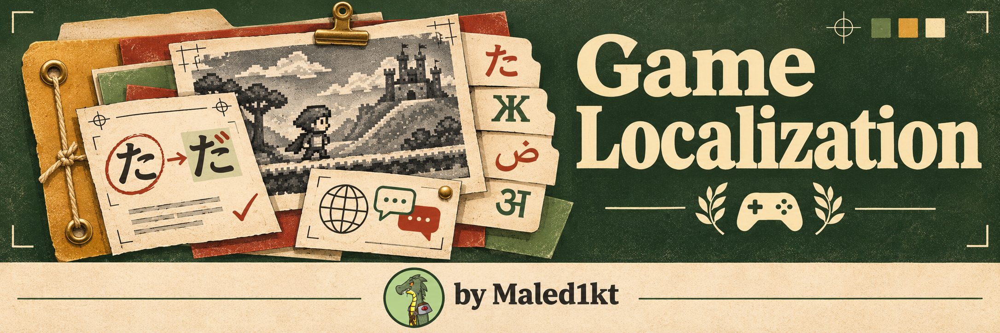

# Game Localization

[English](../README.md) · [Todos los idiomas](../README.md#languages)

Game Localization es una habilidad para agentes que permite traducir, editar y revisar textos de videojuegos en ChatGPT, Codex y Claude. Sirve para menús, tutoriales, diálogos, subtítulos, textos de tienda y documentación de proyectos para Steam, PlayStation, Xbox y juegos para móviles.

[Instalación](#instalación) · [Usar la habilidad](#usar-la-habilidad) · [Actualizar o quitar](#actualizar-o-quitar) · [Apoyar al autor](#apoyar-al-autor) · [Plan de desarrollo](../ROADMAP.md) · [Historial de cambios](../CHANGELOG.md)

## Funciones

- Aplica la terminología aprobada del proyecto y registra los términos nuevos como propuestas.
- Conserva claves de localización, marcadores como `{player_name}` y `%s`, etiquetas, saltos de línea significativos y otros elementos protegidos.
- Comprueba los límites de longitud y separa la traducción de las preguntas, correcciones del original y notas de control de calidad.
- Ofrece una [selección de 30 idiomas y variantes](../game-localization/references/game-localization-rules-v0.1.md#21-select-target-languages) y admite listas personalizadas.
- Incluye un [glosario inicial de 75 términos para los 30 idiomas y variantes](../game-localization/references/glossary/README.md), con definiciones comunes en inglés y propuestas de traducción.

La habilidad contiene instrucciones y archivos de referencia. No requiere clave de API del proyecto, conector ni servicio en segundo plano. La edición de archivos depende de las herramientas del chat. Antes del lanzamiento, revisa la interfaz en una versión del juego y los textos en la vista previa de la tienda.

## Instalación

| Entorno | Paquete |
| --- | --- |
| ChatGPT o Codex con permiso para subir plugins | [ZIP del plugin de ChatGPT](../packages/game-localization-chatgpt-v0.1.12.zip) |
| Claude o espacios de ChatGPT habilitados para subir habilidades independientes | [ZIP de la habilidad independiente](../packages/game-localization-skill-v0.1.12.zip) |
| Codex local o Claude Code | [Instalar desde la carpeta de origen](#instalación-local-con-un-solo-comando) |

En Codex local y Claude Code puedes instalar Game Localization desde el catálogo compartido de GitHub. La guía explica la instalación inicial, el cambio desde el ZIP y cómo actualizar en cada cliente. [Catálogo de GitHub](plugin-catalog.md)

En GitHub, abre el enlace del paquete y pulsa **Download raw file**. Sube el ZIP sin descomprimir.

### ChatGPT y Codex

1. En ChatGPT en la web, abre la opción para subir plugins de tu cuenta. Los propietarios y administradores autorizados pueden usar **Admin console → Plugins → Add → Upload plugin**.
2. Selecciona el ZIP del plugin. Tras la validación, abre **Game Localization** en **Plugins** y elige **Install plugin** si está disponible. Una carga personal puede aparecer en **Personal → Created by me**.
3. Abre un chat nuevo en ChatGPT o Codex. Escribe `@` y selecciona **Game Localization**.

Si tu espacio admite habilidades independientes, usa **Plugins → Skills → Create → Upload from your computer** y sube el ZIP correspondiente. Espera el análisis y sigue las indicaciones. Las opciones dependen de la cuenta y del espacio de trabajo. [Guía de plugins de OpenAI](https://help.openai.com/en/articles/20001256-plugins-in-chatgpt) · [Guía de habilidades de OpenAI](https://help.openai.com/en/articles/20001066-skills-in-chatgpt)

### Claude

1. Activa **Code execution and file creation** en los ajustes de Claude si lo requiere tu cuenta o espacio.
2. En Claude en la web o en Claude Desktop, abre **Customize → Skills**. En el diseño nuevo, abre **Plugins** en la barra lateral y busca los controles en **Your plugins**.
3. Elige **+ → Create skill → Upload a skill** y el ZIP independiente. Activa `game-localization` cuando aparezca.
4. Abre un chat nuevo y pide a Claude que use **Game Localization**. Si la habilidad aparece en **+** o **/** en el cuadro de redacción, selecciónala ahí.

En los espacios gestionados, es posible que un administrador tenga que habilitar o subir las habilidades. [Guía de habilidades de Claude](https://support.claude.com/en/articles/12512180-use-skills-in-claude) · [Nueva barra lateral de Claude](https://support.claude.com/en/articles/17740565-manage-plugins-skills-and-connectors-from-one-plugins-page)

### Instalación local con un solo comando

Los comandos usan la rama `main` de [Maled1kt/game-localization](https://github.com/Maled1kt/game-localization). Funcionarán cuando se publiquen el repositorio y la rama. Los enlaces relativos a los ZIP funcionan también en otras ramas, etiquetas y forks.

En un chat local de Codex, selecciona `$skill-installer` y envía la solicitud siguiente. Autoriza el acceso a la red si se te pide y abre una sesión nueva. [Guía de habilidades de Codex](https://learn.chatgpt.com/docs/build-skills)

~~~text
$skill-installer Install the skill from https://github.com/Maled1kt/game-localization/tree/main/game-localization
~~~

La herramienta externa Skills CLI instala la misma carpeta para Codex local y Claude Code con un comando. Ejecútalo desde el proyecto con Node.js 22.20 o posterior. Conserva las opciones `-a` de los agentes que necesites. Añade `-g` para instalar en tu cuenta local. [Referencia de Skills CLI](https://github.com/vercel-labs/skills/blob/main/docs/commands.md#skills-add)

~~~bash
npx skills add https://github.com/Maled1kt/game-localization/tree/main/game-localization -a codex -a claude-code
~~~

En el chat del terminal local de Claude Code, usa la entrada de la shell para instalar la habilidad solo en Claude. Revisa la URL del repositorio antes de ejecutar el comando. [Entrada de shell en Claude Code](https://code.claude.com/docs/en/interactive-mode#shell-mode-with--prefix)

~~~text
! npx skills add https://github.com/Maled1kt/game-localization/tree/main/game-localization -a claude-code
~~~

Abre una sesión nueva e invoca `$game-localization` en Codex o `/game-localization` en Claude Code. Para la instalación manual, copia toda la carpeta `game-localization/` a `.claude/skills/` del proyecto o a `~/.claude/skills/` de tu usuario. [Guía de habilidades de Claude Code](https://code.claude.com/docs/en/skills)

En las versiones alojadas de ChatGPT y Claude, usa las opciones de carga o instalación de la cuenta. Una mención en el chat invoca la habilidad instalada. Para compartir un enlace, publica en el directorio de la plataforma o comparte la habilidad o el plugin en un espacio que lo permita. [Compartir plugins de ChatGPT](https://help.openai.com/en/articles/20001256-plugins-in-chatgpt) · [Compartir habilidades de Claude](https://support.claude.com/en/articles/12512180-use-skills-in-claude)

## Usar la habilidad

1. Adjunta el texto o archivo de origen y el glosario vigente del proyecto para los idiomas de destino. Si no hay glosario, pide expresamente un borrador.
2. Indica los idiomas de origen y destino, la plataforma, el tipo de contenido y el formato de entrega. Incluye límites de caracteres, capturas, notas sobre los hablantes o ejemplos de variables si son pertinentes.
3. Para una hoja de cálculo, indica las columnas de origen y destino y pide una copia nueva. Para textos del juego, facilita identificadores o claves estables. Para la tienda, indica el campo y el límite estricto si existe.
4. Consulta el informe de entrega por separado para saber si el resultado está listo para usar o sigue siendo un borrador. El informe distingue la comprobación del archivo, la revisión lingüística y la revisión en el juego o en la vista previa de la tienda, e indica el siguiente paso para cada problema pendiente. Aprueba los términos en el glosario del proyecto antes de reutilizarlos.

Para la interfaz del juego, la entrega incluye una lista de comprobaciones priorizadas con la pantalla, el identificador de la cadena, los pasos para reproducir el caso y el criterio para darlo por válido. Empieza por los valores largos de las variables y el texto que podría quedar cortado. Si se conocen la fuente y el ancho útil, la habilidad puede estimar el espacio necesario. [Comprobaciones en el juego](../game-localization/references/in-build-qa.md)

Usa la [plantilla de glosario del proyecto](../game-localization/references/project-glossary-template.md) para separar los términos aprobados de las propuestas. Guarda el archivo actualizado y adjúntalo a tu próximo chat.

**Ejemplo para hojas de cálculo**

~~~text
Usa Game Localization para traducir al alemán (de-DE) la columna ENGLISH del libro adjunto. Escribe las traducciones en GERMAN en una copia .xlsx nueva. Usa el glosario adjunto y la columna DESCRIPTION como contexto. Conserva claves, columnas de origen, marcadores y etiquetas. Enumera por separado las dudas terminológicas y las comprobaciones con los identificadores de fila.
~~~

Para los archivos `.xlsx` compatibles, indica la hoja, la fila de encabezados, la columna con identificadores estables, la columna de origen y la columna de destino existente. Con Python 3.9 o posterior, la habilidad escribe las traducciones por identificador en una copia nueva y comprueba que se conserve el resto del libro. Si no puede comprobar el libro, puede ofrecer un CSV con identificadores. [Instrucciones para Excel](../game-localization/references/xlsx-qa.md)

**Ejemplo para una página de tienda**

~~~text
Usa Game Localization para traducir esta descripción breve de Steam del inglés al portugués de Brasil (pt-BR). Prepara un borrador de glosario si hace falta. Conserva el título del juego y respeta el límite de caracteres indicado. Devuelve el texto de tienda y un informe de entrega separado.
~~~

Para páginas de Steam, la habilidad entrega por separado la descripción breve y la sección «Acerca de este juego», comprueba los límites indicados y las afirmaciones sobre el juego, y puede preparar un borrador a partir de una exportación JSON compatible de Steamworks. El informe de entrega registra por separado la importación y la vista previa. [Flujo de trabajo para páginas de Steam](../game-localization/references/steam-store.md)

### Comprobar traducciones en CSV

Si el CSV tiene identificadores de fila estables, indica los encabezados de las columnas de ID, texto original y traducción. Si está disponible Python 3.9 o una versión posterior, la habilidad compara el archivo original con el traducido y señala los ID que faltan o están duplicados, las traducciones vacías, los cambios en marcadores o etiquetas compatibles y los casos en los que se supera el límite de longitud. [Instrucciones para comprobar archivos CSV](../game-localization/references/csv-qa.md)

Para actualizar una traducción, adjunta el CSV de origen anterior y el actual, las traducciones aprobadas y las correcciones de edición posteriores. La habilidad empareja las filas por identificador, conserva las traducciones válidas de las filas sin cambios y señala las filas añadidas, modificadas y eliminadas. En diálogos largos, guarda el progreso después de cada escena para retomar el mismo archivo de trabajo. [Actualización de traducciones en CSV](../game-localization/references/csv-updates.md)

Prueba el [ejemplo de inicio con 12 filas](../game-localization/examples/first-run/README.md) que incluye un borrador de traducción, un glosario aprobado y un informe de entrega de muestra.

### Nuestra configuración de modelos

| Entorno | Modelo | Nivel de razonamiento |
| --- | --- | --- |
| ChatGPT Work o Codex | GPT-6.1 Sol | High o superior, si está disponible |
| Claude | Claude Opus 5.5 | High o superior, si está disponible |

**High+** se refiere a High o a un nivel superior que ofrezca el cliente. Elige el modelo y el nivel en el cliente. La habilidad funciona con independencia de esta preferencia. [Configuración de modelos de OpenAI](https://learn.chatgpt.com/docs/models) · [Niveles de razonamiento de Claude](https://platform.claude.com/docs/en/build-with-claude/effort)

## Actualizar o quitar

| Instalación | Actualizar | Quitar |
| --- | --- | --- |
| Plugin de ChatGPT o Codex | Si gestionas la carga, usa **Upload new version** en los detalles. Para instalaciones de un directorio o espacio, las actualizaciones provienen de esa fuente. | Abre **Plugins → Installed → Game Localization** y elige **Uninstall plugin** si aparece. Consulta al administrador si es una instalación gestionada. |
| Habilidad independiente de ChatGPT | En la gestión de habilidades, sustituye tu carga personal por el ZIP independiente más reciente. | Abre **Plugins → Skills**, búscala en **Installed** o **Created by me** y usa la opción de retirada cuando esté disponible. Los administradores gestionan las habilidades del espacio. |
| Habilidad personalizada de Claude | Sube el nuevo ZIP desde la página de gestión. Desactiva la versión anterior si aparece una segunda entrada. | Abre la habilidad en **Customize → Skills** o **Plugins** y desactívala. Si la subiste tú, elige **⋯ → Delete** y confirma. |
| Habilidad local instalada con Skills CLI | Ejecuta `npx skills update game-localization` para una rama seguida o instala desde la etiqueta nueva. | Ejecuta `npx skills remove game-localization` desde el mismo proyecto. Añade `-g` si la instalación era global. |
| Carpeta local o Codex Skill Installer | Sustituye la carpeta `game-localization/` por la última versión. | Quita `game-localization/`. Codex puede cargarla desde `.agents/skills/`, `~/.agents/skills/` o `~/.codex/skills/`. Claude Code usa `.claude/skills/` o `~/.claude/skills/`. Inicia otra sesión si hace falta. |

[Gestión de plugins de OpenAI](https://learn.chatgpt.com/docs/plugins) · [Gestión de habilidades personalizadas de Claude](https://support.claude.com/en/articles/12512180-use-skills-in-claude)

## Código fuente y paquetes

- [`game-localization/SKILL.md`](../game-localization/SKILL.md) define cuándo se activa la habilidad y cómo procesa un lote.
- [`game-localization/references/`](../game-localization/references/) contiene las reglas y las versiones del glosario por idioma.
- [`packaging/chatgpt/`](../packaging/chatgpt/) contiene el manifiesto y el icono del plugin.
- [`packages/`](../packages/) contiene los archivos listos para subir.

Para reconstruir los dos ZIP desde el mismo código fuente, ejecuta `python scripts/package.py` en la raíz del repositorio con Python 3.9 o posterior. La versión proviene del manifiesto del plugin. Antes de distribuir, sube cada ZIP a su producto y prueba un lote pequeño con un glosario y un marcador protegido.

## Licencia

Game Localization está disponible bajo la [licencia MIT](../LICENSE). Copyright (c) 2026 [Maled1kt](https://github.com/Maled1kt).

## Apoyar al autor

Si Game Localization ayuda a tu equipo, puedes [apoyar a Maled1kt a través de DonationAlerts](https://www.donationalerts.com/r/maled1kt). Las donaciones son totalmente voluntarias.
