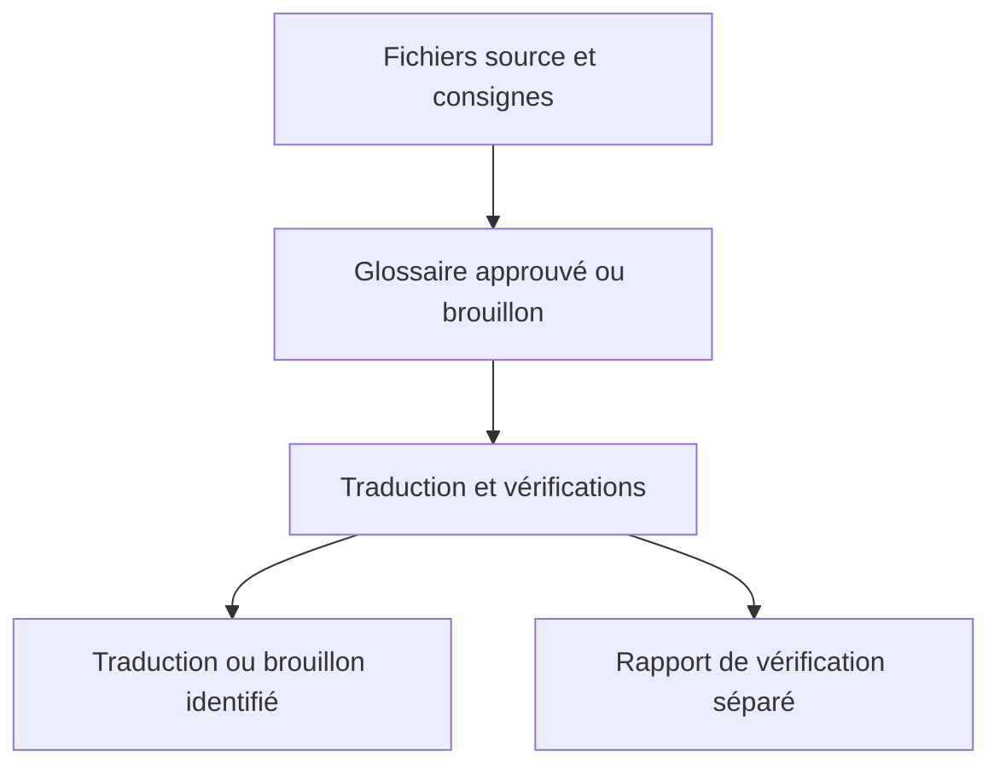

# Game Localization

Game Localization est une compétence d’agent pour traduire, réviser et contrôler les textes de jeux vidéo dans ChatGPT, Codex et Claude. Elle couvre les menus, tutoriels, dialogues, sous-titres, textes de boutique et documents de projet pour Steam, PlayStation, Xbox et les jeux mobiles.

Vous recevez une traduction et un rapport de vérification séparé.

**[Installation](#installation)** · **[Essayez l’exemple de 12 chaînes](../game-localization/examples/first-run/README.md)** · [Utiliser la compétence](#utiliser-la-compétence) · [Soutenir l’auteur](#soutenir-lauteur)

Cette version du README a été traduite avec Game Localization. Comparez-la à l’original en anglais pour vous faire une idée du résultat.

[English](../README.md) · [Toutes les langues](../README.md#languages)

## Installation

| Environnement | Paquet |
| --- | --- |
| ChatGPT ou Codex avec accès à l’import de plugins | [ZIP du plugin ChatGPT](../packages/game-localization-chatgpt-v0.1.13.zip) |
| Claude ou espace ChatGPT autorisant l’import de compétences autonomes | [ZIP de la compétence autonome](../packages/game-localization-skill-v0.1.13.zip) |
| Codex local ou Claude Code | [Catalogue GitHub](plugin-catalog.md) |

Sur GitHub, ouvrez le lien du paquet et choisissez **Download raw file**. Importez le ZIP sans le décompresser.

[Détails de l’installation](#setup-details) · [Installer depuis le dossier source](#installation-des-agents-locaux-en-une-commande)

## Utiliser la compétence

### Comment ça marche

1. Joignez le texte ou fichier source et le glossaire de projet pour les langues cibles. Sans glossaire, demandez explicitement une première version.
2. Précisez langues source et cibles, plateforme, type de contenu et format de sortie. Ajoutez au besoin limites de caractères, captures, notes sur les locuteurs ou exemples de variables.
3. Pour un classeur, indiquez les colonnes source et cible et demandez une nouvelle copie. Pour le jeu, fournissez des clés ou identifiants stables. Pour la boutique, indiquez le champ cible et la limite stricte éventuelle.
4. Consultez le compte rendu séparé pour savoir si le résultat est prêt à l’emploi ou reste à l’état de brouillon. Il distingue le contrôle du fichier, la révision linguistique et la vérification dans le jeu ou dans l’aperçu de la boutique. Il indique la prochaine action pour chaque problème en suspens. Approuvez les termes dans le glossaire du projet avant de les réutiliser.

### Choisissez une méthode

| Format | À fournir | Vous recevez |
| --- | --- | --- |
| [CSV](../game-localization/references/csv-qa.md) | CSV avec identifiants de ligne stables (avec les fichiers précédents pour une mise à jour) | Traduction vérifiée ou rapport des modifications |
| [Excel](../game-localization/references/xlsx-qa.md) | Classeur, feuille et colonnes d’identifiants, source et cible | Copie vérifiée du classeur |
| [Steam](../game-localization/references/steam-store.md) | Texte de la boutique ou export Steamworks | Champs localisés ou brouillon JSON |

Exemples de demandes et vérifications des fichiers

Pour l’interface du jeu, le rapport de livraison contient une liste de vérifications classées par priorité. Chaque cas précise l’écran, l’identifiant de la chaîne, les étapes de reproduction et le critère de réussite. Les valeurs de variables longues et les textes susceptibles d’être tronqués passent en premier. Si la police et la largeur utile sont connues, la compétence peut estimer l’espace nécessaire. [Vérifications dans le jeu](../game-localization/references/in-build-qa.md)

Utilisez le [modèle de glossaire de projet](../game-localization/references/project-glossary-template.md) pour séparer les termes approuvés des propositions. Enregistrez le fichier mis à jour et joignez-le à votre prochaine conversation.

**Requête pour un classeur**

~~~text
Utilise Game Localization pour traduire en allemand (de-DE) la colonne ENGLISH du classeur joint. Écris les traductions dans GERMAN, dans une nouvelle copie .xlsx. Utilise le glossaire joint et la colonne DESCRIPTION comme contexte. Préserve les clés, colonnes source, variables et balises. Liste séparément les questions terminologiques et les contrôles avec les identifiants de ligne.
~~~

Pour les fichiers `.xlsx` pris en charge, indiquez la feuille, la ligne d’en-tête, la colonne des identifiants stables, la colonne source et la colonne cible existante. Avec Python 3.9 ou une version ultérieure, la compétence écrit les traductions par identifiant dans une nouvelle copie et vérifie que le reste du classeur est préservé. Si le classeur ne peut pas être vérifié, elle peut proposer un CSV avec les identifiants. [Instructions pour Excel](../game-localization/references/xlsx-qa.md)

**Requête pour une page de boutique**

~~~text
Utilise Game Localization pour traduire cette description courte Steam de l’anglais vers le portugais du Brésil (pt-BR). Prépare un glossaire provisoire si nécessaire. Garde le titre du jeu et respecte la limite de caractères indiquée. Rends le texte et un compte rendu séparé.
~~~

Pour les pages Steam, la compétence livre séparément la description courte et la rubrique « À propos de ce jeu », vérifie les limites indiquées et les affirmations sur le jeu, et peut préparer un brouillon à partir d’un export JSON Steamworks pris en charge. Le rapport de livraison suit séparément l’importation et l’aperçu. [Procédure pour les pages Steam](../game-localization/references/steam-store.md)

### Vérifier les traductions CSV

Pour un fichier CSV avec des identifiants de ligne stables, indiquez les en-têtes des colonnes d’identifiant, de texte source et de traduction. Si Python 3.9 ou une version ultérieure est disponible, la compétence compare les fichiers source et traduit. Elle signale les identifiants manquants ou en double, les traductions vides, les modifications de variables ou de balises prises en charge et les dépassements des limites de longueur. [Instructions de vérification des CSV](../game-localization/references/csv-qa.md)

Pour mettre à jour une traduction, joignez les versions précédente et actuelle du CSV source, les traductions approuvées et les retouches éditoriales ultérieures. La compétence rapproche les lignes par identifiant, conserve les formulations réutilisables pour les lignes inchangées et signale les ajouts, les modifications et les suppressions. Pour les longs dialogues, enregistrez l’avancement après chaque scène pour reprendre avec le même fichier de travail. [Mettre à jour une traduction CSV](../game-localization/references/csv-updates.md)

## Fonctionnalités

- Applique la terminologie approuvée du projet et consigne les nouveaux termes comme propositions.
- Préserve les clés de localisation, les variables comme `{player_name}` et `%s`, les balises, les sauts de ligne significatifs et les autres éléments protégés.
- Vérifie les limites de longueur et sépare la traduction des questions, des corrections du texte source et des notes de contrôle qualité.
- Propose une [sélection de 30 langues et variantes](../game-localization/references/game-localization-rules-v0.1.md#21-select-target-languages) et accepte des listes personnalisées.
- Comprend un [glossaire de départ de 75 termes dans les 30 langues et variantes](../game-localization/references/glossary/README.md), avec des définitions communes en anglais et des propositions de traduction.

La compétence contient des instructions et des références. Elle fonctionne sans clé API de projet, connecteur ni service en arrière-plan. La modification de fichiers dépend des outils du chat. Avant la sortie, vérifiez l’interface traduite dans le jeu et les textes de boutique dans l’aperçu de la plateforme.

## Mettre à jour ou supprimer

| Installation | Mettre à jour | Supprimer |
| --- | --- | --- |
| [Catalogue GitHub](plugin-catalog.md) | [Claude Code](plugin-catalog.md#claude-code) · [Codex](plugin-catalog.md#local-codex) | [Supprimer](plugin-catalog.md#remove-the-catalog-installation) |
| Plugin ChatGPT ou Codex | Si vous gérez l’import, choisissez **Upload new version** dans les détails du plugin. Les installations de catalogue ou d’espace reçoivent leurs mises à jour de cette source. | Ouvrez **Plugins → Installed → Game Localization** et choisissez **Uninstall plugin** si proposé. Pour une installation gérée, contactez l’administrateur. |
| Compétence autonome ChatGPT | Remplacez votre import personnel par le ZIP autonome le plus récent depuis la gestion des compétences. | Dans **Plugins → Skills**, trouvez-la sous **Installed** ou **Created by me** et choisissez l’option de suppression si disponible. Les administrateurs gèrent les compétences de l’espace. |
| Compétence personnalisée Claude | Importez le nouveau ZIP autonome depuis la page de gestion. Désactivez l’ancienne version si l’import crée une deuxième entrée. | Ouvrez-la sous **Customize → Skills** ou **Plugins**, désactivez-la et choisissez **⋯ → Delete** pour votre propre import. Confirmez. |
| Compétence locale installée avec Skills CLI | Pour une branche suivie, exécutez `npx skills update game-localization` ou installez depuis le nouveau tag. | Exécutez `npx skills remove game-localization` dans le même projet. Ajoutez `-g` si l’installation était globale. |
| Dossier local ou Codex Skill Installer | Remplacez le dossier `game-localization/` par la dernière version. | Supprimez `game-localization/`. Codex peut le charger depuis `.agents/skills/`, `~/.agents/skills/` ou `~/.codex/skills/`. Claude Code utilise `.claude/skills/` ou `~/.claude/skills/`. Ouvrez une nouvelle session si nécessaire. |

[Gestion des plugins OpenAI](https://learn.chatgpt.com/docs/plugins) · [Gestion des compétences personnalisées Claude](https://support.claude.com/en/articles/12512180-use-skills-in-claude)

## Détails de l’installation

### ChatGPT et Codex

1. Dans ChatGPT sur le Web, ouvrez l’option d’import de plugins de votre compte. Les propriétaires et administrateurs autorisés peuvent utiliser **Admin console → Plugins → Add → Upload plugin**.
2. Sélectionnez le ZIP du plugin ChatGPT. Après validation, ouvrez **Game Localization** dans **Plugins** et choisissez **Install plugin** si proposé. Un import personnel peut apparaître sous **Personal → Created by me**.
3. Ouvrez un nouveau chat dans ChatGPT ou Codex. Saisissez `@` et sélectionnez **Game Localization**.

Si votre espace accepte les compétences autonomes, utilisez **Plugins → Skills → Create → Upload from your computer** pour importer le ZIP de la compétence. Attendez l’analyse et suivez les indications. Les options dépendent du compte et de l’espace. [Guide des plugins OpenAI](https://help.openai.com/en/articles/20001256-plugins-in-chatgpt) · [Guide des compétences OpenAI](https://help.openai.com/en/articles/20001066-skills-in-chatgpt)

### Claude

1. Activez **Code execution and file creation** dans Claude si votre compte ou espace l’exige.
2. Sur le Web ou dans Claude Desktop, ouvrez **Customize → Skills**. Dans la nouvelle interface, ouvrez **Plugins** dans la barre latérale et cherchez les commandes sous **Your plugins**.
3. Choisissez **+ → Create skill → Upload a skill** et sélectionnez le ZIP autonome. Activez `game-localization` dès qu’elle apparaît.
4. Ouvrez un nouveau chat et demandez à Claude d’utiliser **Game Localization**. Si la zone de saisie la propose sous **+** ou **/**, sélectionnez-la.

Dans un espace géré, un administrateur peut devoir activer ou importer les compétences. [Guide des compétences Claude](https://support.claude.com/en/articles/12512180-use-skills-in-claude) · [Nouvelle barre latérale Claude](https://support.claude.com/en/articles/17740565-manage-plugins-skills-and-connectors-from-one-plugins-page)

### Installation des agents locaux en une commande

Afficher les commandes d’installation manuelle

Dans un chat Codex local, sélectionnez `$skill-installer` et envoyez la requête ci-dessous. Autorisez l’accès réseau si nécessaire, puis démarrez une nouvelle session. [Guide des compétences Codex](https://learn.chatgpt.com/docs/build-skills)

~~~text
$skill-installer Install the skill from https://github.com/Maled1kt/game-localization/tree/main/game-localization
~~~

L’outil tiers Skills CLI installe le même dossier pour Codex local et Claude Code en une commande. Exécutez-la depuis le projet avec Node.js 22.20 ou ultérieur. Gardez les options `-a` des agents voulus et ajoutez `-g` pour une installation au niveau utilisateur. [Référence Skills CLI](https://github.com/vercel-labs/skills/blob/main/docs/commands.md#skills-add)

~~~bash
npx skills add https://github.com/Maled1kt/game-localization/tree/main/game-localization -a codex -a claude-code
~~~

Dans le chat du terminal local de Claude Code, utilisez la saisie shell pour installer la compétence pour Claude seul. Vérifiez l’URL du dépôt avant de lancer la commande. [Saisie shell dans Claude Code](https://code.claude.com/docs/en/interactive-mode#shell-mode-with--prefix)

~~~text
! npx skills add https://github.com/Maled1kt/game-localization/tree/main/game-localization -a claude-code
~~~

Dans une nouvelle session, invoquez `$game-localization` dans Codex ou `/game-localization` dans Claude Code. Pour une installation manuelle, copiez tout le dossier `game-localization/` dans `.claude/skills/` du projet ou `~/.claude/skills/` pour votre compte. [Guide des compétences Claude Code](https://code.claude.com/docs/en/skills)

Dans ChatGPT et Claude hébergés, utilisez les commandes d’import ou d’installation du compte. Une mention appelle la compétence installée. Pour un lien partageable, publiez via le catalogue de la plateforme ou partagez la compétence ou le plugin dans un espace admissible. [Partager un plugin ChatGPT](https://help.openai.com/en/articles/20001256-plugins-in-chatgpt) · [Partager une compétence Claude](https://support.claude.com/en/articles/12512180-use-skills-in-claude)

## Sources et empaquetage

- [`game-localization/SKILL.md`](../game-localization/SKILL.md) définit quand la compétence intervient et comment elle traite un lot.
- [`game-localization/references/`](../game-localization/references/) contient les règles et les versions du glossaire de départ.
- [`packaging/plugin/`](../packaging/plugin/) contient le manifeste et l’icône du plugin.
- [`packages/`](../packages/) contient les archives prêtes à importer.

Pour reconstruire les deux ZIP, exécutez `python scripts/package.py` à la racine du dépôt avec Python 3.9 ou ultérieur. Le numéro de version vient du manifeste du plugin ChatGPT. Avant diffusion, importez chaque ZIP dans le produit prévu et testez un petit lot avec un glossaire et une variable protégée.

### Nos réglages de modèles

| Environnement | Modèle | Niveau de raisonnement |
| --- | --- | --- |
| ChatGPT Work ou Codex | GPT-6.1 Sol | High ou supérieur, selon disponibilité |
| Claude | Claude Opus 5.5 | High ou supérieur, selon disponibilité |

**High+** désigne High ou un niveau supérieur disponible dans le client. Choisissez-y le modèle et le niveau. La compétence fonctionne indépendamment de ce réglage. [Réglages des modèles OpenAI](https://learn.chatgpt.com/docs/models) · [Niveaux de raisonnement de Claude](https://platform.claude.com/docs/en/build-with-claude/effort)

[Mettre à jour ou supprimer](#mettre-à-jour-ou-supprimer) · [Plan de développement](../ROADMAP.md) · [Journal des modifications](../CHANGELOG.md)

## Licence

Game Localization est disponible sous [licence MIT](../LICENSE). Copyright (c) 2026 [Maled1kt](https://github.com/Maled1kt).

## Soutenir l’auteur

Si Game Localization aide votre équipe, vous pouvez [soutenir Maled1kt via DonationAlerts](https://www.donationalerts.com/r/maled1kt). Les dons sont entièrement facultatifs.
