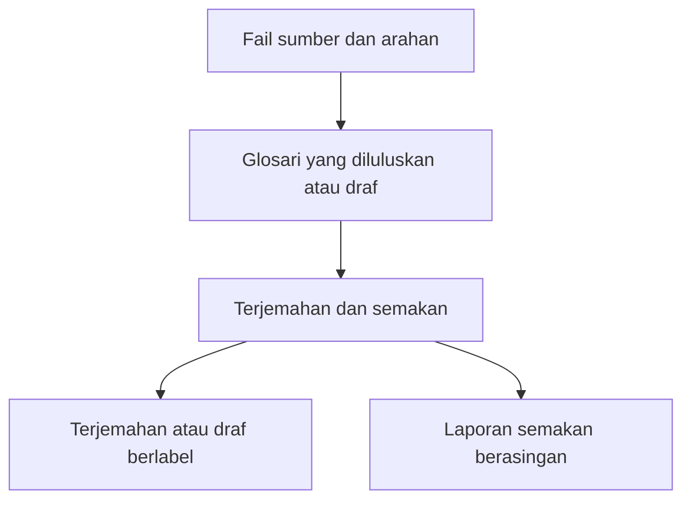

# Game Localization

Game Localization ialah kemahiran ejen untuk menterjemah, menyunting dan menyemak teks permainan video dalam ChatGPT, Codex dan Claude. Ia meliputi menu, tutorial, dialog, sari kata, teks kedai dan dokumentasi projek untuk Steam, PlayStation, Xbox serta permainan mudah alih.

Anda menerima terjemahan dan laporan semakan berasingan.

**[Pemasangan](#pemasangan)** · **[Cuba contoh 12 rentetan](../game-localization/examples/first-run/README.md)** · [Menggunakan kemahiran](#menggunakan-kemahiran) · [Sokong pengarang](#sokong-pengarang)

Versi README ini diterjemahkan dengan Game Localization. Bandingkannya dengan teks asal dalam bahasa Inggeris untuk menilai hasilnya.

[English](../README.md) · [Semua bahasa](../README.md#languages)

## Pemasangan

| Persekitaran | Pakej |
| --- | --- |
| ChatGPT atau Codex dengan kebenaran memuat naik pemalam | [ZIP pemalam ChatGPT](../packages/game-localization-chatgpt-v0.1.13.zip) |
| Claude atau ruang kerja ChatGPT yang layak memuat naik kemahiran kendiri | [ZIP kemahiran kendiri](../packages/game-localization-skill-v0.1.13.zip) |
| Codex setempat atau Claude Code | [Katalog GitHub](plugin-catalog.md) |

Buka pautan pakej di GitHub dan pilih **Download raw file**. Muat naik ZIP tanpa mengekstraknya.

[Butiran pemasangan](#setup-details) · [Pasang daripada folder sumber](#pemasangan-setempat-dengan-satu-perintah)

## Menggunakan kemahiran

### Cara kemahiran ini berfungsi

1. Lampirkan teks atau fail sumber dan glosari projek terkini untuk bahasa sasaran. Jika belum ada, minta draf glosari dengan jelas.
2. Nyatakan bahasa sumber dan sasaran, platform, jenis bahan dan format keluaran. Sertakan had aksara, tangkapan skrin, catatan penutur atau contoh pemboleh ubah jika perlu.
3. Bagi hamparan, namakan lajur sumber dan sasaran serta minta salinan baharu. Bagi rentetan permainan, berikan ID atau kunci tetap. Bagi teks kedai, nyatakan medan sasaran dan had wajib jika ada.
4. Baca laporan serahan berasingan untuk mengetahui sama ada hasilnya sedia digunakan atau masih draf. Laporan itu menyenaraikan semakan fail, semakan bahasa dan semakan dalam permainan atau pratonton kedai secara berasingan, berserta tindakan seterusnya bagi setiap isu tertunggak. Luluskan istilah dalam glosari projek sebelum menggunakannya semula.

### Pilih aliran kerja

| Format | Bahan yang diperlukan | Hasil yang diterima |
| --- | --- | --- |
| [CSV](../game-localization/references/csv-qa.md) | CSV dengan ID baris tetap (serta fail terdahulu untuk kemas kini) | Terjemahan yang disemak atau laporan perubahan |
| [Excel](../game-localization/references/xlsx-qa.md) | Buku kerja, lembaran dan lajur ID, sumber serta sasaran | Salinan buku kerja yang disahkan |
| [Steam](../game-localization/references/steam-store.md) | Teks kedai atau eksport Steamworks | Medan yang disetempatkan atau draf JSON |

Contoh arahan dan semakan fail

Untuk antara muka permainan, laporan serahan menyertakan senarai semak mengikut keutamaan dengan skrin, ID rentetan, langkah mengulangi senario dan kriteria lulus. Semakan bermula dengan nilai pemboleh ubah yang panjang dan teks yang mungkin terpotong. Jika fon dan lebar yang tersedia diketahui, kemahiran ini boleh menganggarkan ruang yang diperlukan. [Semakan dalam permainan](../game-localization/references/in-build-qa.md)

Gunakan [templat glosari projek](../game-localization/references/project-glossary-template.md) untuk mengasingkan istilah yang diluluskan daripada cadangan. Simpan fail yang dikemas kini dan lampirkannya dalam sembang seterusnya.

**Contoh gesaan hamparan**

~~~text
Gunakan Game Localization untuk menterjemah lajur ENGLISH dalam buku kerja yang dilampirkan ke bahasa Jerman (de-DE). Tulis terjemahan ke GERMAN dalam salinan .xlsx baharu. Gunakan glosari lampiran dan lajur DESCRIPTION sebagai konteks. Kekalkan kunci, lajur sumber, pemegang tempat dan tag. Senaraikan soalan istilah dan hasil semakan secara berasingan bersama ID baris.
~~~

Untuk fail `.xlsx` yang disokong, nyatakan lembaran kerja, baris pengepala, lajur ID tetap, lajur sumber dan lajur sasaran sedia ada. Dengan Python 3.9 atau lebih baharu, kemahiran ini menulis terjemahan mengikut ID dalam salinan baharu dan menyemak sama ada bahagian lain buku kerja dikekalkan. Jika buku kerja tidak dapat disahkan, kemahiran ini boleh menawarkan CSV dengan ID. [Panduan Excel](../game-localization/references/xlsx-qa.md)

**Contoh gesaan halaman kedai**

~~~text
Gunakan Game Localization untuk menyetempatkan perihalan ringkas Steam ini daripada bahasa Inggeris ke bahasa Portugis Brazil (pt-BR). Sediakan draf glosari jika perlu. Kekalkan tajuk permainan dan patuhi had aksara yang diberi. Berikan teks kedai dan laporan serahan secara berasingan.
~~~

Untuk halaman Steam, kemahiran ini menyediakan perihalan ringkas dan bahagian Perihal Permainan Ini secara berasingan, menyemak had yang diberi dan dakwaan tentang permainan, serta boleh menyediakan draf daripada eksport JSON Steamworks yang disokong. Laporan serahan merekodkan status import dan pratonton secara berasingan. [Aliran kerja halaman Steam](../game-localization/references/steam-store.md)

### Menyemak terjemahan CSV

Jika fail CSV mempunyai ID baris yang tetap, nyatakan tajuk lajur ID, teks sumber dan terjemahan. Jika Python 3.9 atau versi lebih baharu tersedia, kemahiran membandingkan fail sumber dengan fail terjemahan dan menandakan ID yang hilang atau berulang, terjemahan kosong, perubahan pada pemegang tempat atau tag yang disokong dan terjemahan yang melebihi had panjang. [Panduan semakan CSV](../game-localization/references/csv-qa.md)

Untuk mengemas kini terjemahan, lampirkan CSV sumber terdahulu dan semasa, terjemahan yang diluluskan serta suntingan kemudian. Kemahiran ini memadankan baris mengikut ID, mengekalkan terjemahan yang masih sesuai bagi baris yang sama, dan menandakan baris yang ditambah, diubah atau dibuang. Bagi dialog panjang, simpan kemajuan selepas setiap adegan supaya anda boleh menyambung dengan fail kerja yang sama. [Kemas kini terjemahan CSV](../game-localization/references/csv-updates.md)

## Ciri

- Menggunakan istilah projek yang diluluskan dan merekodkan istilah baharu sebagai cadangan.
- Mengekalkan kunci penyetempatan, pemegang tempat seperti `{player_name}` dan `%s`, tag, pemisah baris yang bermakna dan unsur terlindung lain.
- Menyemak had panjang dan mengasingkan terjemahan daripada soalan, pembetulan sumber dan catatan semakan kualiti.
- Menyediakan [senarai pratetap 30 bahasa dan varian](../game-localization/references/game-localization-rules-v0.1.md#21-select-target-languages) dan menerima senarai tersuai.
- Merangkumi [glosari permulaan 75 istilah bagi semua 30 bahasa dan varian](../game-localization/references/glossary/README.md), dengan takrif bersama dalam bahasa Inggeris dan cadangan terjemahan.

Kemahiran mengandungi arahan dan fail rujukan. Ia boleh digunakan tanpa kunci API projek, penyambung atau perkhidmatan latar. Penyuntingan fail bergantung pada alat dalam sembang. Sebelum keluaran, semak antara muka dalam binaan permainan dan teks kedai dalam pratonton platform.

## Kemas kini atau alih keluar

| Pemasangan | Kemas kini | Alih keluar |
| --- | --- | --- |
| [Katalog GitHub](plugin-catalog.md) | [Claude Code](plugin-catalog.md#claude-code) · [Codex](plugin-catalog.md#local-codex) | [Alih keluar](plugin-catalog.md#remove-the-catalog-installation) |
| Pemalam ChatGPT atau Codex | Jika anda mengurus muat naik, pilih **Upload new version** pada butiran pemalam. Pemasangan daripada direktori atau ruang kerja mendapat kemas kini daripada sumber itu. | Buka **Plugins → Installed → Game Localization** dan pilih **Uninstall plugin** jika tersedia. Rujuk pentadbir untuk pemasangan terurus. |
| Kemahiran kendiri ChatGPT | Gunakan kawalan pengurusan untuk menggantikan muat naik peribadi dengan ZIP kendiri terkini. | Buka **Plugins → Skills**, cari dalam **Installed** atau **Created by me** dan gunakan pilihan alih keluar jika ada. Pentadbir mengurus kemahiran milik ruang kerja. |
| Kemahiran tersuai Claude | Muat naik ZIP kendiri baharu melalui halaman pengurusan. Nyahdayakan versi terdahulu jika muncul entri kedua. | Buka dalam **Customize → Skills** atau **Plugins** dan nyahdayakan. Untuk muat naik sendiri, pilih **⋯ → Delete** dan sahkan. |
| Kemahiran setempat melalui Skills CLI | Jalankan `npx skills update game-localization` bagi cabang yang dijejaki atau pasang daripada tag baharu. | Jalankan `npx skills remove game-localization` dalam projek yang sama. Tambah `-g` jika dipasang secara global. |
| Folder setempat atau Codex Skill Installer | Gantikan folder `game-localization/` yang dipasang dengan versi terkini. | Alih keluar folder `game-localization/`. Codex boleh memuatkannya dari `.agents/skills/`, `~/.agents/skills/` atau `~/.codex/skills/`. Claude Code menggunakan `.claude/skills/` atau `~/.claude/skills/`. Mulakan sesi baharu jika perlu. |

[Pengurusan pemalam OpenAI](https://learn.chatgpt.com/docs/plugins) · [Pengurusan kemahiran tersuai Claude](https://support.claude.com/en/articles/12512180-use-skills-in-claude)

## Butiran pemasangan

### ChatGPT dan Codex

1. Dalam ChatGPT di web, buka pilihan muat naik pemalam bagi akaun anda. Pemilik dan pentadbir yang diberi kebenaran boleh menggunakan **Admin console → Plugins → Add → Upload plugin**.
2. Pilih ZIP pemalam. Selepas pengesahan, buka **Game Localization** dalam **Plugins** dan pilih **Install plugin** jika tersedia. Muat naik peribadi boleh dipaparkan di **Personal → Created by me**.
3. Mulakan sembang baharu dalam ChatGPT atau Codex. Taip `@` dan pilih **Game Localization** daripada cadangan.

Jika ruang kerja menyokong kemahiran kendiri, muat naik ZIP tersebut melalui **Plugins → Skills → Create → Upload from your computer**. Tunggu imbasan dan ikut panduan. Pilihan bergantung pada akaun dan ruang kerja. [Panduan pemalam OpenAI](https://help.openai.com/en/articles/20001256-plugins-in-chatgpt) · [Panduan kemahiran OpenAI](https://help.openai.com/en/articles/20001066-skills-in-chatgpt)

### Claude

1. Dayakan **Code execution and file creation** dalam tetapan Claude jika akaun atau ruang kerja memerlukannya.
2. Dalam Claude di web atau Claude Desktop, buka **Customize → Skills**. Dalam susun atur baharu, buka **Plugins** pada bar sisi dan cari kawalan dalam **Your plugins**.
3. Pilih **+ → Create skill → Upload a skill** dan ZIP kemahiran kendiri. Dayakan `game-localization` apabila dipaparkan.
4. Mulakan sembang baharu dan minta Claude menggunakan **Game Localization**. Jika kemahiran muncul di bawah **+** atau **/** dalam ruangan mesej, pilih di situ.

Dalam ruang kerja terurus, pentadbir mungkin perlu mendayakan atau memuat naik kemahiran. [Panduan kemahiran Claude](https://support.claude.com/en/articles/12512180-use-skills-in-claude) · [Bar sisi baharu Claude](https://support.claude.com/en/articles/17740565-manage-plugins-skills-and-connectors-from-one-plugins-page)

### Pemasangan setempat dengan satu perintah

Papar perintah pemasangan manual

Dalam sembang Codex setempat, pilih `$skill-installer` terbina dalam dan hantar permintaan di bawah. Benarkan capaian rangkaian jika diminta, kemudian mulakan sesi baharu. [Panduan kemahiran Codex](https://learn.chatgpt.com/docs/build-skills)

~~~text
$skill-installer Install the skill from https://github.com/Maled1kt/game-localization/tree/main/game-localization
~~~

Skills CLI pihak ketiga memasang folder sumber yang sama untuk Codex setempat dan Claude Code dengan satu perintah. Jalankan dari projek sasaran dengan Node.js 22.20 atau lebih baharu. Kekalkan pilihan `-a` untuk ejen yang diperlukan. Tambah `-g` untuk pemasangan bagi pengguna merentas projek. [Rujukan Skills CLI](https://github.com/vercel-labs/skills/blob/main/docs/commands.md#skills-add)

~~~bash
npx skills add https://github.com/Maled1kt/game-localization/tree/main/game-localization -a codex -a claude-code
~~~

Dalam sembang terminal setempat Claude Code, gunakan input shell untuk memasang bagi Claude sahaja. Semak URL repositori sebelum menjalankannya. [Input shell Claude Code](https://code.claude.com/docs/en/interactive-mode#shell-mode-with--prefix)

~~~text
! npx skills add https://github.com/Maled1kt/game-localization/tree/main/game-localization -a claude-code
~~~

Dalam sesi baharu, panggil `$game-localization` dalam Codex atau `/game-localization` dalam Claude Code. Untuk pemasangan manual, salin seluruh folder `game-localization/` ke `.claude/skills/` projek atau `~/.claude/skills/` pengguna. [Panduan kemahiran Claude Code](https://code.claude.com/docs/en/skills)

Pada ChatGPT dan Claude yang dihoskan, gunakan kawalan muat naik atau pemasangan akaun. Sebutan dalam sembang memanggil kemahiran yang dipasang. Untuk pautan pemasangan yang boleh dikongsi, terbitkan melalui direktori yang disokong atau kongsi kemahiran atau pemalam dalam ruang kerja yang layak. [Perkongsian pemalam ChatGPT](https://help.openai.com/en/articles/20001256-plugins-in-chatgpt) · [Perkongsian kemahiran Claude](https://support.claude.com/en/articles/12512180-use-skills-in-claude)

## Kod sumber dan pakej

- [`game-localization/SKILL.md`](../game-localization/SKILL.md) menentukan bila kemahiran dijalankan dan cara kumpulan teks diproses.
- [`game-localization/references/`](../game-localization/references/) mengandungi peraturan dan edisi glosari mengikut bahasa.
- [`packaging/plugin/`](../packaging/plugin/) mengandungi manifes dan ikon pemalam.
- [`packages/`](../packages/) mengandungi arkib sedia untuk dimuat naik.

Untuk membina semula kedua-dua ZIP daripada sumber yang sama, jalankan `python scripts/package.py` dari akar repositori dengan Python 3.9 atau lebih baharu. Versi ditentukan oleh manifes pemalam ChatGPT. Sebelum edaran, muat naik setiap ZIP ke produk berkenaan dan uji kumpulan teks kecil dengan glosari dan pemegang tempat terlindung.

### Tetapan model kami

| Persekitaran | Model | Tahap penaakulan |
| --- | --- | --- |
| ChatGPT Work atau Codex | GPT-6.1 Sol | High atau lebih tinggi jika tersedia |
| Claude | Claude Opus 5.5 | High atau lebih tinggi jika tersedia |

**High+** merujuk kepada High atau tahap lebih tinggi yang tersedia dalam aplikasi. Pilih model dan tahap penaakulan dalam aplikasi. Kemahiran berfungsi tanpa bergantung pada tetapan ini. [Tetapan model OpenAI](https://learn.chatgpt.com/docs/models) · [Tahap penaakulan Claude](https://platform.claude.com/docs/en/build-with-claude/effort)

[Kemas kini atau alih keluar](#kemas-kini-atau-alih-keluar) · [Pelan pembangunan](../ROADMAP.md) · [Log perubahan](../CHANGELOG.md)

## Lesen

Game Localization disediakan di bawah [Lesen MIT](../LICENSE). Copyright (c) 2026 [Maled1kt](https://github.com/Maled1kt).

## Sokong pengarang

Jika Game Localization membantu pasukan anda, anda boleh [menyokong Maled1kt melalui DonationAlerts](https://www.donationalerts.com/r/maled1kt). Sumbangan adalah sukarela.
