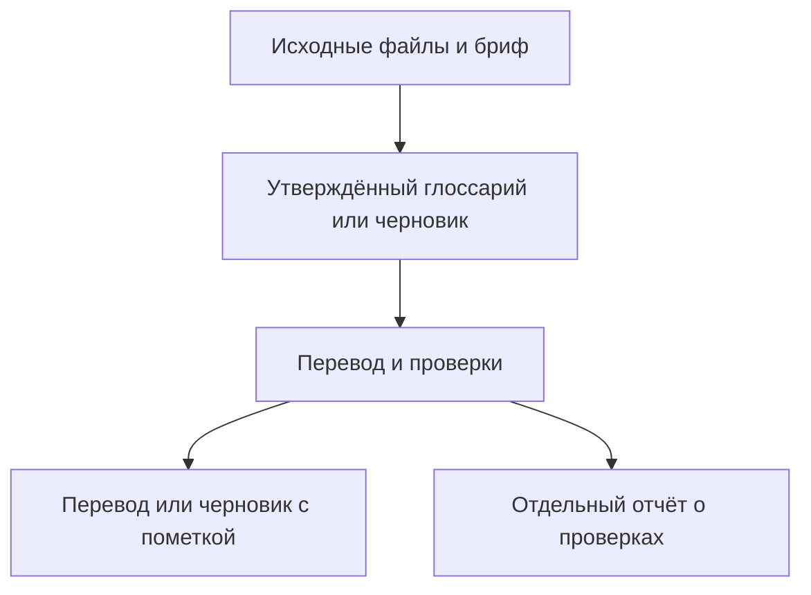

# Game Localization

Game Localization — навык для агентов, который переводит, редактирует и проверяет тексты видеоигр в ChatGPT, Codex и Claude. Подходит для меню, обучения, диалогов, субтитров, текстов магазинов и проектной документации для Steam, PlayStation, Xbox и мобильных игр.

Вы получите перевод и отдельный отчёт о проверках.

**[Установка](#установка)** · **[Попробовать пример на 12 строках](../game-localization/examples/first-run/README.md)** · [Как пользоваться навыком](#как-пользоваться-навыком) · [Поддержать автора](#поддержать-автора)

Эта версия README переведена с помощью Game Localization. Сравните её с английским оригиналом и оцените результат.

[English](../README.md) · [Все языки](../README.md#languages)

## Установка

| Среда | Пакет |
| --- | --- |
| ChatGPT или Codex с правом загрузки плагинов | [ZIP плагина ChatGPT](../packages/game-localization-chatgpt-v0.1.13.zip) |
| Claude или рабочие пространства ChatGPT с правом загрузки отдельных навыков | [ZIP отдельного навыка](../packages/game-localization-skill-v0.1.13.zip) |
| Локальный Codex или Claude Code | [Каталог GitHub](plugin-catalog.md) |

Откройте ссылку на пакет в GitHub и выберите **Download raw file**. Загружайте ZIP целиком.

[Подробности установки](#setup-details) · [Установка из папки с исходниками](#установка-одной-командой-для-локальных-агентов)

## Как пользоваться навыком

### Как это работает

1. Приложите текст или файл исходника и актуальный глоссарий проекта для целевых локалей. Если глоссария нет, прямо попросите подготовить черновик.
2. Укажите исходную и целевые локали, платформу, тип материала и формат результата. При необходимости приложите ограничения по символам, скриншоты, сведения о говорящих или примеры значений переменных.
3. Для таблицы назовите исходные и целевые колонки и попросите новую копию. Для строк игры предоставьте стабильные ID или ключи. Для магазина укажите нужное поле и жёсткое ограничение длины, если оно есть.
4. В отдельном отчёте указано, готов ли результат к использованию или пока это черновик. В нём отдельно показаны проверки файла, перевода и текста в игре или предпросмотре магазина. Для каждой нерешённой проблемы указан следующий шаг. Утвердите термины в глоссарии проекта перед повторным использованием.

### Выберите сценарий

| Формат | Что приложить | Что получите |
| --- | --- | --- |
| [CSV](../game-localization/references/csv-qa.md) | CSV с постоянными ID строк (для обновления — также предыдущие файлы) | Проверенный перевод или отчёт об изменениях |
| [Excel](../game-localization/references/xlsx-qa.md) | Книга Excel, лист и колонки с ID, исходником и переводом | Проверенная копия книги |
| [Steam](../game-localization/references/steam-store.md) | Текст страницы магазина или экспорт Steamworks | Перевод по полям или черновик JSON |

Примеры запросов и проверки файлов

Для игрового интерфейса отчёт включает список проверок по приоритету. В каждой указаны экран, ID строки, шаги воспроизведения и ожидаемый результат. Сначала проверяют длинные подстановки и текст, который может обрезаться. Если известны шрифт и доступная ширина, навык может оценить, сколько места займёт текст. [Проверки в игре](../game-localization/references/in-build-qa.md)

Используйте [шаблон глоссария проекта](../game-localization/references/project-glossary-template.md), чтобы хранить утверждённые термины отдельно от предложений. Сохраните обновлённый файл и приложите его к следующему чату.

**Пример запроса для таблицы**

~~~text
Используй Game Localization, чтобы перевести колонку ENGLISH приложенной книги на немецкий (de-DE). Запиши перевод в GERMAN в новой копии .xlsx. Возьми контекст из приложенного глоссария и колонки DESCRIPTION. Сохрани ключи, исходные колонки, плейсхолдеры и теги. Вынеси вопросы по терминологии и результаты проверок отдельно, с ID строк.
~~~

Для поддерживаемых файлов `.xlsx` укажите лист, строку заголовков, колонку с постоянными ID, исходную колонку и существующую колонку перевода. При наличии Python 3.9 или новее навык записывает переводы по ID в новую копию и проверяет, что остальная часть книги сохранилась. Если проверить книгу не удаётся, навык может предложить CSV с ID строк. [Инструкция по работе с Excel](../game-localization/references/xlsx-qa.md)

**Пример запроса для страницы магазина**

~~~text
Используй Game Localization, чтобы перевести это краткое описание Steam с английского на бразильский португальский (pt-BR). При необходимости начни черновик глоссария. Сохрани название игры и соблюдай заданный лимит символов. Выдай текст для магазина и отдельный отчёт.
~~~

Для страниц Steam навык выдаёт краткое описание и раздел «Об этой игре» отдельно, проверяет заданные лимиты и факты об игре и может подготовить черновик из поддерживаемого JSON-экспорта Steamworks. В отчёте отдельно отмечены импорт и предпросмотр. [Работа со страницами Steam](../game-localization/references/steam-store.md)

### Проверка переводов в CSV

Если у строк CSV есть постоянные ID, укажите названия колонок с ID, исходным текстом и переводом. Когда доступен Python 3.9 или новее, навык сравнивает исходный файл с переводом и сообщает о пропущенных или повторяющихся ID, пустых переводах, изменениях в поддерживаемых плейсхолдерах и тегах и превышении заданных лимитов длины. [Инструкция по проверке CSV](../game-localization/references/csv-qa.md)

Чтобы обновить перевод, приложите предыдущий и текущий исходные CSV, утверждённые переводы и более поздние правки редактора. Навык сопоставит строки по ID, сохранит подходящие переводы для неизменённых строк и отметит добавленные, изменённые и удалённые строки. В длинных диалогах сохраняйте прогресс после каждой сцены, чтобы продолжить с тем же рабочим файлом. [Обновление переводов CSV](../game-localization/references/csv-updates.md)

## Возможности

- Применяет утверждённую терминологию проекта и сохраняет новые термины как черновые варианты.
- Сохраняет ключи локализации, плейсхолдеры вроде `{player_name}` и `%s`, теги, значимые переносы строк и другие защищённые элементы.
- Проверяет заданные ограничения длины и выдаёт перевод отдельно от вопросов, правок исходника и замечаний по качеству.
- Предлагает [пресет из 30 языков и локалей](../game-localization/references/game-localization-rules-v0.1.md#21-select-target-languages) и позволяет задать собственный список.
- Включает [стартовый глоссарий из 75 терминов для всех 30 языков и локалей](../game-localization/references/glossary/README.md) с общими определениями на английском и черновыми переводами.

Навык содержит инструкции и справочные файлы. Он работает без ключа API проекта, коннектора и фонового сервиса. Редактирование файлов зависит от инструментов в чате. Перед релизом проверьте интерфейс в игровой сборке, а тексты магазина — в предпросмотре платформы.

## Обновление и удаление

| Способ установки | Обновление | Удаление |
| --- | --- | --- |
| [Каталог GitHub](plugin-catalog.md) | [Claude Code](plugin-catalog.md#claude-code) · [Codex](plugin-catalog.md#local-codex) | [Удаление](plugin-catalog.md#remove-the-catalog-installation) |
| Плагин ChatGPT или Codex | Если вы управляете загрузкой, выберите **Upload new version** на странице плагина. Для установок из каталога или рабочего пространства обновления приходят из этого источника. | Откройте **Plugins → Installed → Game Localization** и выберите **Uninstall plugin**, если пункт доступен. По управляемой установке обратитесь к администратору. |
| Отдельный навык ChatGPT | Замените личную загрузку свежим ZIP отдельного навыка через управление навыками. | Откройте **Plugins → Skills**, найдите навык в **Installed** или **Created by me** и воспользуйтесь удалением, если оно доступно. Навыками рабочего пространства управляют его администраторы. |
| Пользовательский навык Claude | Загрузите новый ZIP через управление навыками. Если появится вторая запись, отключите предыдущую версию. | Откройте навык в **Customize → Skills** или **Plugins**, отключите его и выберите **⋯ → Delete** для собственной загрузки. Подтвердите удаление. |
| Локальный навык из Skills CLI | Выполните `npx skills update game-localization` для отслеживаемой ветки или установите навык из нового тега. | Выполните `npx skills remove game-localization` в том же проекте. Для глобальной установки добавьте `-g`. |
| Локальная папка или Codex Skill Installer | Замените папку `game-localization/` новой версией. | Удалите папку `game-localization/`. Codex может загружать её из `.agents/skills/`, `~/.agents/skills/` или `~/.codex/skills/`. Claude Code использует `.claude/skills/` или `~/.claude/skills/`. При необходимости начните новый сеанс. |

[Управление плагинами OpenAI](https://learn.chatgpt.com/docs/plugins) · [Управление пользовательскими навыками Claude](https://support.claude.com/en/articles/12512180-use-skills-in-claude)

## Подробности установки

### ChatGPT и Codex

1. Откройте загрузку плагинов в веб-версии ChatGPT. Владельцы и администраторы с правом загрузки могут использовать **Admin console → Plugins → Add → Upload plugin**.
2. Выберите ZIP плагина. После проверки откройте **Game Localization** в **Plugins** и выберите **Install plugin**, если пункт доступен. Личная загрузка может появиться в **Personal → Created by me**.
3. Откройте новый чат в ChatGPT или Codex. Введите `@` и выберите **Game Localization**.

Если рабочее пространство поддерживает отдельные навыки, загрузите ZIP через **Plugins → Skills → Create → Upload from your computer**. Дождитесь проверки и следуйте подсказкам. Доступные варианты зависят от аккаунта и рабочего пространства. [Руководство OpenAI по плагинам](https://help.openai.com/en/articles/20001256-plugins-in-chatgpt) · [Руководство OpenAI по навыкам](https://help.openai.com/en/articles/20001066-skills-in-chatgpt)

### Claude

1. Включите **Code execution and file creation** в настройках Claude, если этого требует ваш аккаунт или рабочее пространство.
2. В веб-версии Claude или Claude Desktop откройте **Customize → Skills**. В новом интерфейсе выберите **Plugins** на боковой панели и найдите управление навыками в **Your plugins**.
3. Выберите **+ → Create skill → Upload a skill** и ZIP отдельного навыка. Включите `game-localization`, когда он появится в списке.
4. Откройте новый чат и попросите Claude использовать **Game Localization**. Если навык доступен в поле ввода через **+** или **/**, выберите его там.

В управляемом рабочем пространстве включение или загрузка навыков может потребовать участия администратора. [Руководство Claude по навыкам](https://support.claude.com/en/articles/12512180-use-skills-in-claude) · [Новая боковая панель Claude](https://support.claude.com/en/articles/17740565-manage-plugins-skills-and-connectors-from-one-plugins-page)

### Установка одной командой для локальных агентов

Показать команды ручной установки

В локальном чате Codex выберите встроенный `$skill-installer` и отправьте запрос ниже. Разрешите доступ к сети, если появится запрос, затем начните новый сеанс. [Руководство Codex по навыкам](https://learn.chatgpt.com/docs/build-skills)

~~~text
$skill-installer Install the skill from https://github.com/Maled1kt/game-localization/tree/main/game-localization
~~~

Сторонняя утилита Skills CLI устанавливает одну папку с исходниками для локального Codex и Claude Code одной командой. Запустите её из нужного проекта с Node.js 22.20 или новее. Оставьте параметры `-a` для нужных агентов. Добавьте `-g` для установки на уровне пользователя. [Справка Skills CLI](https://github.com/vercel-labs/skills/blob/main/docs/commands.md#skills-add)

~~~bash
npx skills add https://github.com/Maled1kt/game-localization/tree/main/game-localization -a codex -a claude-code
~~~

В локальном терминальном чате Claude Code используйте ввод команд оболочки для установки только в Claude. Перед запуском проверьте адрес репозитория. [Ввод команд в Claude Code](https://code.claude.com/docs/en/interactive-mode#shell-mode-with--prefix)

~~~text
! npx skills add https://github.com/Maled1kt/game-localization/tree/main/game-localization -a claude-code
~~~

В новом сеансе вызовите `$game-localization` в Codex или `/game-localization` в Claude Code. Для ручной установки скопируйте папку `game-localization/` целиком в `.claude/skills/` проекта или в `~/.claude/skills/` для своего пользователя. [Руководство Claude Code по навыкам](https://code.claude.com/docs/en/skills)

В облачных версиях ChatGPT и Claude пользуйтесь средствами загрузки или установки аккаунта. Упоминание в чате вызывает установленный навык. Чтобы получить ссылку на установку, опубликуйте навык через поддерживаемый каталог платформы или поделитесь навыком либо плагином в рабочем пространстве с такой возможностью. [Общий доступ к плагинам ChatGPT](https://help.openai.com/en/articles/20001256-plugins-in-chatgpt) · [Общий доступ к навыкам Claude](https://support.claude.com/en/articles/12512180-use-skills-in-claude)

## Исходники и сборка пакетов

- [`game-localization/SKILL.md`](../game-localization/SKILL.md) определяет, когда запускается навык и как он обрабатывает пакет строк.
- [`game-localization/references/`](../game-localization/references/) содержит правила и версии стартового глоссария по локалям.
- [`packaging/plugin/`](../packaging/plugin/) содержит манифест и иконку плагина.
- [`packages/`](../packages/) содержит архивы для загрузки.

Чтобы собрать оба ZIP из одних исходников, выполните `python scripts/package.py` в корне репозитория с Python 3.9 или новее. Версия берётся из манифеста плагина ChatGPT. Перед распространением загрузите каждый ZIP в соответствующий продукт и проверьте небольшой пакет строк с глоссарием и защищённым плейсхолдером.

### Наши настройки моделей

| Среда | Модель | Уровень рассуждений |
| --- | --- | --- |
| ChatGPT Work или Codex | GPT-6.1 Sol | High или выше, если доступно |
| Claude | Claude Opus 5.5 | High или выше, если доступно |

**High+** означает High или более высокий уровень, доступный в приложении. Выберите модель и уровень в приложении. Навык работает независимо от этой настройки. [Настройки моделей OpenAI](https://learn.chatgpt.com/docs/models) · [Уровни рассуждений Claude](https://platform.claude.com/docs/en/build-with-claude/effort)

[Обновление и удаление](#обновление-и-удаление) · [План развития](../ROADMAP.md) · [История изменений](../CHANGELOG.md)

## Лицензия

Game Localization распространяется по [лицензии MIT](../LICENSE). Copyright (c) 2026 [Maled1kt](https://github.com/Maled1kt).

## Поддержать автора

Если Game Localization помогает вашей команде, вы можете [поддержать Maled1kt через DonationAlerts](https://www.donationalerts.com/r/maled1kt). Пожертвования полностью добровольны.
